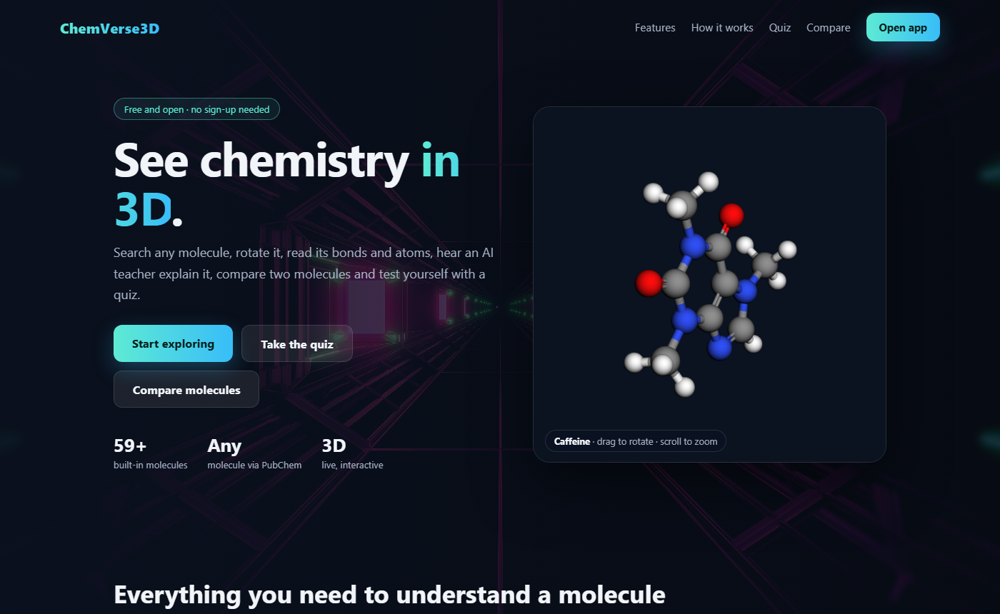
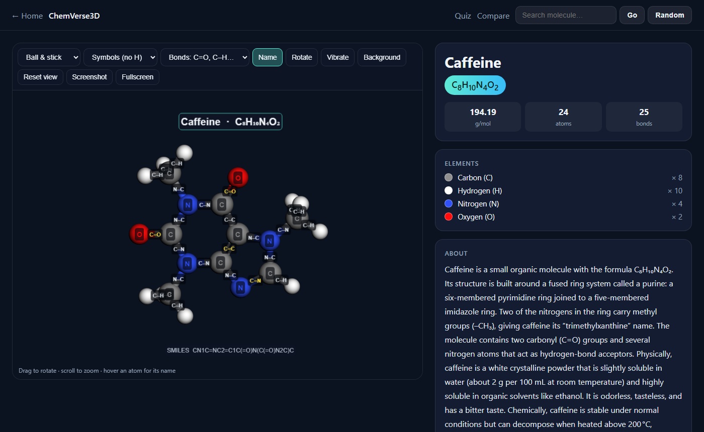
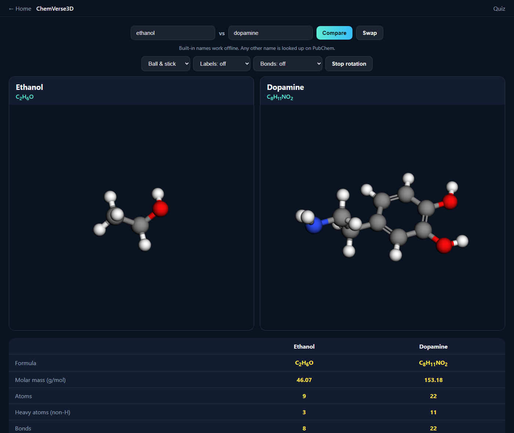
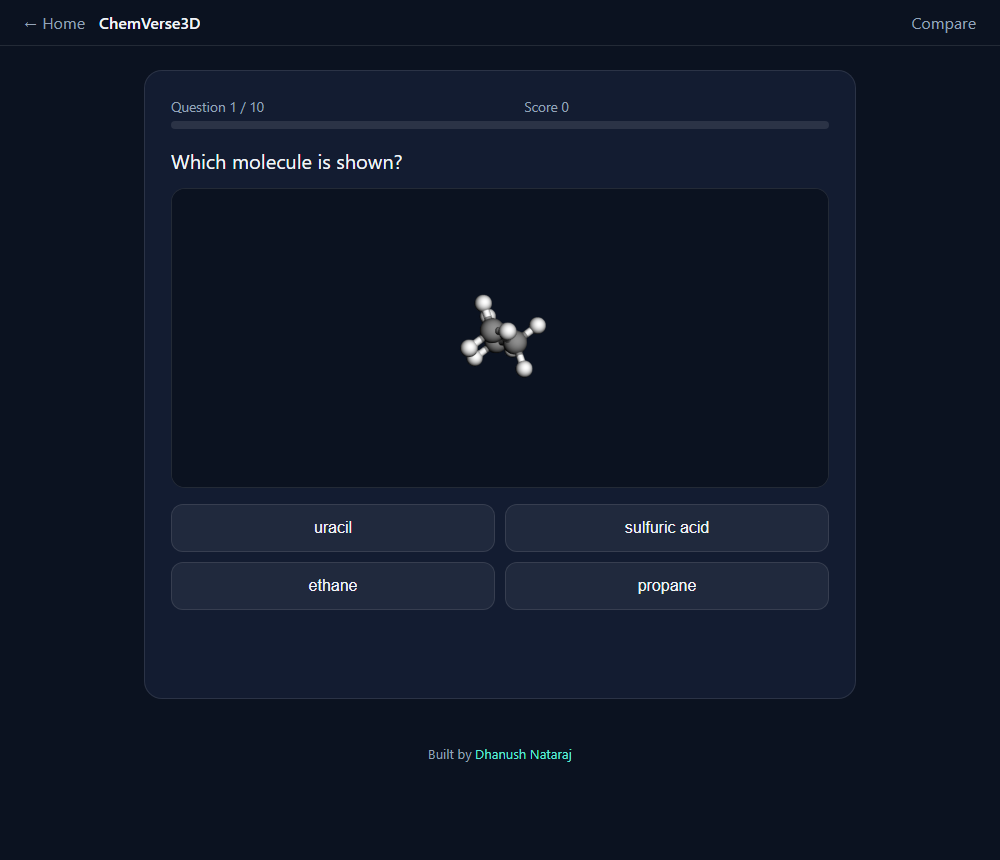
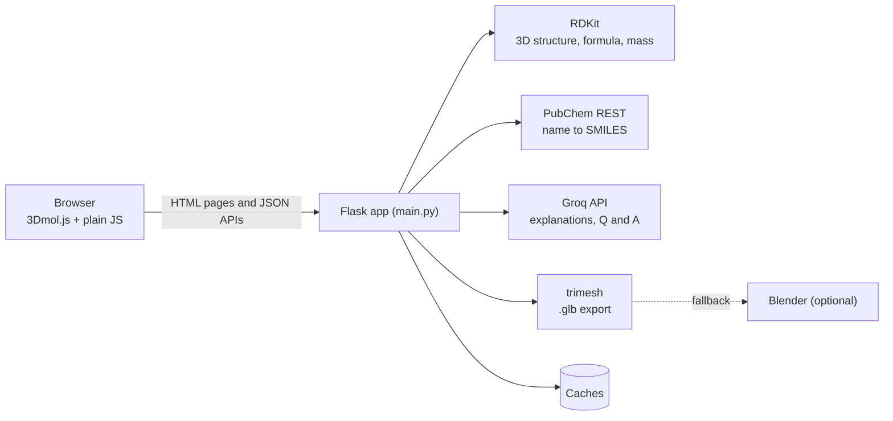

# ChemVerse3D

[](https://github.com/DhanushN2005/Ai-Based-3d---molecule-visualizer/actions/workflows/ci.yml)


<!-- TODO: after deploying on Render, add the live link here: **Live demo:** https://<your-service>.onrender.com -->

An AI-powered web app for **exploring chemical molecules in 3D**. Search any molecule, rotate it, read its structure notation, hear an AI explanation, compare it with another molecule, and test yourself with a quiz.

---

## 🚀 Project Overview

Understanding molecular structures through textbooks is often abstract and difficult.  
This project bridges that gap by building **3D molecular models** from chemical data (RDKit + PubChem) and letting users visualize, interact with, and explore them in a more intuitive way.

It is a Flask app: RDKit builds the 3D structure, 3Dmol.js draws it live in the browser, trimesh exports a `.glb` file, and Groq writes the explanations.

---

## ✨ Key Features

- 🔎 **Any molecule**: 59 built-in molecules, plus anything on **PubChem** (dopamine, ibuprofen, vitamin C…)
- 🧬 **Live 3D viewer** (3Dmol.js): rotate, zoom, 4 draw styles, vibration animation, screenshot, fullscreen
- 🎨 **Full element colours** (Jmol/CPK) shared by the viewer, legend and `.glb` export
- 🏷️ **Structure notation in 3D**: name + formula floating above the molecule, colour-coded atom labels, and bond labels such as `C–H`, `C=O`, `C≡N`
- ⚖️ **Compare** two molecules side by side with a differences table and an AI summary
- 🎯 **Quiz mode** with **server-side scoring**: identify molecules in 3D, recall formulas, count atoms. Answers never reach the browser until you answer
- 👤 **Accounts**: sign up, save **favourite** molecules, and appear on the **leaderboard**
- 💾 **Database** (SQLite or Postgres) caches PubChem molecules and AI explanations so they survive restarts
- 🤖 **AI explanation** and "Ask the AI teacher" (Groq), with sentence-highlighted text-to-speech
- 📦 Downloads: `.glb` (built with trimesh, Blender as fallback) and `.sdf`

See [FEATURES.md](FEATURES.md) for the roadmap and what could come next.

## Screenshots

| Cover | Viewer with bond notation |
|---|---|
|  |  |

| Compare | Quiz |
|---|---|
|  |  |

---

## 🛠️ Tech Stack

- **Backend:** Python, Flask
- **Chemistry:** RDKit (3D structures, formula, mass), PubChem PUG REST (name lookup)
- **3D:** 3Dmol.js (live viewer), trimesh (`.glb` export), Blender scripting (optional fallback)
- **AI:** Groq API (explanations, Q&A, comparisons)
- **Speech:** the browser's built-in Web Speech API
- **Frontend:** plain HTML, CSS and JavaScript (no build step)

> **Note:** Explanations use the free Groq API. You need a `GROQ_API_KEY`. See [Requirements](#requirements).

---

## ⚙️ How it works

Type a molecule name (for example `caffeine` or `dopamine`) and the app:

1. Finds its SMILES string: first in `molecules_db.py`, otherwise on **PubChem** (cached in `data/pubchem_cache.json`).
2. Builds a 3D structure with **RDKit** (one conformer, used for the viewer, the `.sdf` and the `.glb`).
3. Sends the atoms and bonds to the browser, where **3Dmol.js** draws them with element colours, labels and bond notation.
4. Builds a `.glb` model with **trimesh** for download and AR. If that fails, it falls back to a generated Blender script.
5. Shows an AI-written explanation (**Groq**) with a "Speak" button and an "Ask the AI teacher" box.

---

## Architecture



Request flows, security measures, scaling limits and design decisions are in [docs/ARCHITECTURE.md](docs/ARCHITECTURE.md).

## 📂 Project Structure

| File | Purpose |
|---|---|
| `main.py` | Flask app: pages (`/` cover, `/search`, `/viewer/<name>`, `/compare`, `/quiz`) and JSON APIs (`/api/ask`, `/api/compare`, `/api/quiz`, `/api/suggest`, `/api/frames/<name>`), PubChem lookup, rate limiting |
| `elements.py` | One colour table for every element (unknown elements are bright pink) |
| `static/js/molview.js` | Shared 3Dmol.js wrapper: styles, labels, bond notation, hover |
| `molecules_db.py` | The list of molecules and their SMILES |
| `generate_xyz.py` | Builds the 3D molecule with RDKit and writes `molecules/<name>.xyz` |
| `glb_trimesh.py` | Builds `outputs/<name>.glb` with trimesh (default) |
| `blender_script_gen.py` | Fallback: writes `molecules/<name>_blender.py` (spheres for atoms, cylinders for bonds) |
| `export_glb_blender.py` | Finds and runs Blender, which produces `outputs/<name>.glb` |
| `models.py` | SQLAlchemy models: users, favourites, quiz sessions, cached molecules and explanations |
| `accounts.py` | Blueprint: register, login, logout, CSRF protection, favourites, leaderboard |
| `ratelimit.py` | In-memory sliding-window rate limiter |
| `tests/` | pytest suite (fake PubChem and Groq, no network) |
| `docs/` | `ARCHITECTURE.md` and the README screenshots |
| `Dockerfile`, `render.yaml`, `.github/workflows/ci.yml` | Container image, Render blueprint, CI pipeline |
| `templates/` | HTML pages: `cover.html` (landing), `index.html` (search), `viewer.html`, `compare.html`, `quiz.html`, `error.html` |

Generated files go to `molecules/` (`.xyz`), `outputs/` (`.glb`) and `data/` (PubChem cache). All three are git-ignored. Roadmap: [FEATURES.md](FEATURES.md).


_Add a screenshot of the viewer here (use the 📷 Screenshot button)._

---

## How many molecules can it generate?

Any molecule PubChem knows, up to 80 heavy atoms (set `MAX_HEAVY_ATOMS` in `.env` to change it). PubChem needs internet; results are cached in `data/pubchem_cache.json` (git-ignored). The built-in list below works offline.

Built-in list:

**59 names, which is 58 different molecules.** `aspirin` and `acetylsalicylic acid` are the same molecule.

| Group | Molecules |
|---|---|
| Alkanes, alkenes, alkynes, aromatics | methane, ethane, propane, butane, pentane, hexane, ethene, ethyne, benzene |
| Alcohols | methanol, ethanol, propanol, butanol, isopropanol, glycerol |
| Acids | formic acid, acetic acid, propanoic acid, butanoic acid, benzoic acid |
| Amines | methylamine, ethylamine, aniline |
| Aldehydes and ketones | formaldehyde, acetaldehyde, acetone |
| Carbohydrates | glucose, fructose, sucrose |
| Amino acids | glycine, alanine, valine, leucine, phenylalanine, tryptophan |
| Inorganic | water, ammonia, carbon dioxide, nitric acid, sulfuric acid, phosphoric acid, hydrogen peroxide, ozone |
| Nucleobases | adenine, guanine, cytosine, uracil, thymine |
| Biological and drugs | cholesterol, caffeine, nicotine, aspirin, acetylsalicylic acid, paracetamol |
| Gases | oxygen, hydrogen, nitrogen, chlorine, fluorine |

**To add more built-in molecules:** add one line to `MOLECULE_DB` in `molecules_db.py` (`"name": "SMILES"`). The formula, mass and element counts are computed automatically. Anything not in the list is looked up on PubChem anyway, so this only matters for offline use and the quiz.

## Requirements

- Windows, Python 3.10+
- [Blender](https://www.blender.org/download/) is **optional**. Models are built with `trimesh` by default; Blender (2.8+, 4.x recommended) is only used as a fallback if that fails.
- Python packages:

```powershell
pip install -r requirements.txt
```

- A free [Groq](https://console.groq.com/keys) API key for the explanations (no model download needed).

### Configuration (`.env`)

Copy the example file and fill it in:

```powershell
copy .env.example .env
```

| Variable | Required | Default | Purpose |
|---|---|---|---|
| `GROQ_API_KEY` | For explanations | none | Groq API key. Without it the 3D model still works and the explanation box says it is unavailable. |
| `GROQ_MODEL` | No | `openai/gpt-oss-20b` | Groq model used for explanations. |
| `BLENDER_PATH` | No | auto-detected | Full path to `blender.exe` if it is not on PATH or in `C:\Program Files\Blender Foundation\`. |
| `HOST` | No | `127.0.0.1` | Interface the server listens on. |
| `PORT` | No | `5000` | Port the server listens on. |
| `FLASK_DEBUG` | No | `0` | `1` enables debug mode. Local development only. |
| `MAX_HEAVY_ATOMS` | No | `80` | Largest PubChem molecule the app will build. |
| `SECRET_KEY` | **Yes, in production** | random per start | Signs login cookies. Without it, everyone is logged out on each restart. |
| `DATABASE_URL` | No | SQLite file in `DATA_DIR` | Any SQLAlchemy URL, for example hosted Postgres (`postgresql://...`). Use this for data that must survive redeploys. |
| `SESSION_COOKIE_SECURE` | No | off | Set to `1` when served over HTTPS so the login cookie is HTTPS-only. |
| `LOG_LEVEL` | No | `INFO` | Python log level (`DEBUG`, `INFO`, `WARNING`...). |
| `DATA_DIR` | No | `data` | Folder for the SQLite database file. |
| `PUBCHEM_LOOKUPS_PER_MIN` | No | `20` | New-molecule PubChem lookups allowed per visitor per minute. |
| `TRUST_PROXY` | No | off | Set to `1` only when deployed behind a proxy (Render, Hugging Face) so rate limits use each visitor's real IP. |

`.env` is in `.gitignore`, so your key is never committed. On a hosting service, set these as environment variables or secrets instead of uploading `.env`.

## How to run

```powershell
cd "E:\project\AI&ML\chemistry"
python main.py
```

Open <http://127.0.0.1:5000> for the cover page, click **Start exploring**, type a molecule name and submit. Generation usually takes under a second.

Always start the app from the project folder, because it uses relative paths such as `outputs/` and `molecules/`.

## Using the app

| Page | What you can do |
|---|---|
| **Cover** (`/`) | Landing page with a live 3D demo, the feature list and buttons into the app. No login or sign-up. |
| **Search** (`/search`) | Search a molecule (suggestions come from the built-in list and PubChem), or click a chip. |
| **Viewer** (`/viewer/<name>`) | Rotate and zoom, switch style (ball and stick, stick, space-filling, wireframe), show atom labels (symbols or element names), show bond notation (`–` `=` `≡` or `C=O`, `C–H`), toggle the floating name, vibrate, change background, screenshot, fullscreen. Hover an atom for its element name. Read or hear the AI explanation, ask the AI a question, download `.glb` or `.sdf`. |
| **Compare** (`/compare?a=water&b=ammonia`) | Two molecules side by side, differences highlighted in a table, plus an AI summary. |
| **Quiz** (`/quiz`) | 10 questions: identify the molecule in 3D, pick the formula, count atoms. The server checks each answer and computes your score. |
| **Account** (`/register`, `/login`) | Create an account with a username and password (8+ characters). No email needed. |
| **Favourites** (`/favorites`) | Molecules you starred on the viewer page. |
| **Leaderboard** (`/leaderboard`) | Best score per signed-in player on a full 10-question quiz. Guests can play but are not listed. If a guest logs in or signs up right after finishing a quiz (within an hour, same browser), that quiz is credited to the new account. |

The viewer can start in a given state through the URL, which is handy for sharing:
`/viewer/caffeine?style=stick&labels=name&bonds=pair&bg=light&spin=0&name=0`
(`style`: `bs` `stick` `sphere` `line`; `labels`: `off` `sym` `symnoh` `name`; `bonds`: `off` `order` `pair`).

### Limits to know about
- PubChem needs internet. The viewer loads 3Dmol.js from a CDN, so it needs internet and WebGL too.
- The `.glb` file has no labels or animation. Those exist only in the live viewer and in screenshots.
- AI calls and PubChem lookups are rate limited per IP (in memory, per process). A shared store such as Redis is the next step before adding workers.
- The leaderboard is a learning feature, not an exam: it has no timer and does not stop someone from replaying many times.
- Without a persistent database (see `DATABASE_URL`), accounts on a host with an ephemeral disk are lost on redeploy.

### Blender fallback (optional)
If trimesh fails, the app looks for Blender in this order:
1. The `BLENDER_PATH` environment variable
2. `blender` on your PATH
3. The newest `C:\Program Files\Blender Foundation\Blender *\blender.exe`

If none exist, the app shows "Blender not found" with instructions.

### Debug mode
Off by default. For local development only: set `FLASK_DEBUG=1` in `.env`.

## Development

```powershell
pip install -r requirements.txt -r requirements-dev.txt
pytest --cov          # 113 tests, about 90% coverage; no network or API key needed
ruff check .          # lint
```

The tests use a fake PubChem and a fake Groq, so they are fast and never spend quota. They cover molecule building, the `.glb` export and Blender fallback, every API route, PubChem failures, rate limiting, path traversal, the security headers, and the account system (registration, login, CSRF, open-redirect and session-fixation protection, favourites, server-side quiz scoring and the leaderboard). GitHub Actions runs lint, tests (Python 3.11 and 3.12) and a Docker build with a health-check smoke test on every push.

Other endpoints for operations: `GET /healthz` returns `{"status": "ok"}` and does no chemistry or network work. Logs go to stdout; set `LOG_LEVEL` to change verbosity.

### Docker

```bash
docker build -t chemverse3d .
docker run -p 8000:8000 -e GROQ_API_KEY=your-key chemverse3d
```

Open <http://localhost:8000>. Add `-e TRUST_PROXY=1` only when running behind a reverse proxy. The image runs as a non-root user with one gunicorn worker.

## Deploy free on Render

The repo includes a `render.yaml` blueprint.

1. Push the repo to GitHub. Never commit `.env`.
2. On [render.com](https://render.com): **New → Blueprint**, choose this repo, and approve the plan (`free`).
3. When asked, paste your `GROQ_API_KEY` (it is stored in Render, not in git).
4. Wait for the build. Your app is at `https://chemverse3d.onrender.com` (or the name Render gives you).

What the blueprint sets:
- **Start command:** `gunicorn main:app --workers 1 --threads 4 --timeout 120 --bind 0.0.0.0:$PORT`. One worker on purpose: the rate limiter and caches live in memory.
- **`TRUST_PROXY=1`** so rate limits work per visitor.
- **Python 3.11.9** and a health check on `/healthz`.

Accounts, favourites and leaderboard scores live in the database. Render's free web service has an ephemeral disk, so with the default SQLite file they are **wiped on every redeploy**. To keep them, create a free hosted Postgres (for example Neon or Supabase) and add its connection string as the `DATABASE_URL` environment variable in the Render dashboard. The app has been run against a real hosted Postgres (Neon, PostgreSQL 18): sign-up, favourites, the quiz, the leaderboard query and the molecule cache all worked. The automated tests always use a throwaway SQLite file, and refuse to run against any other database.

Free-tier behaviour to expect (check Render's pricing page for current limits):
- About 512 MB RAM. The app has no torch or Blender, so it should fit.
- The service sleeps after about 15 minutes idle; the first visit then takes 30 to 60 seconds.
- The disk resets on restart. That is fine: `.glb` files and the PubChem cache are rebuilt on demand.
- gunicorn does not run on Windows. Use `python main.py` locally.

## Built by

**Dhanush Nataraj**. Portfolio: [dhanushnataraj.netlify.app](https://dhanushnataraj.netlify.app)

ChemVerse3D is a personal project that combines chemistry (RDKit, PubChem), 3D graphics (3Dmol.js, trimesh) and AI (Groq) in one Flask web app.

## Troubleshooting

- **"Blender not found"**: only appears if trimesh failed too. Check the console for the trimesh error, or install Blender / set `BLENDER_PATH`.
- **"Blender Failed" in the console**: the Blender output is printed there. Look at the STDERR section.
- **"not found in the built-in list or on PubChem"**: check the spelling, or try a common synonym. Names are case-insensitive.
- **"Too many requests" or "Too many new-molecule lookups"**: the built-in rate limits (per IP, per minute). Wait a minute.
- **Speak does nothing**: click the Speak button itself (browsers block speech without a click). The page shows the reason if the browser refuses.
- **Viewer is blank**: the page loads 3Dmol.js from a CDN, so it needs internet and WebGL.
- **Explanation unavailable**: set `GROQ_API_KEY` (see Requirements) and check the console for a Groq error.
- **Explanations look odd**: they are written by an LLM, so double-check facts.
