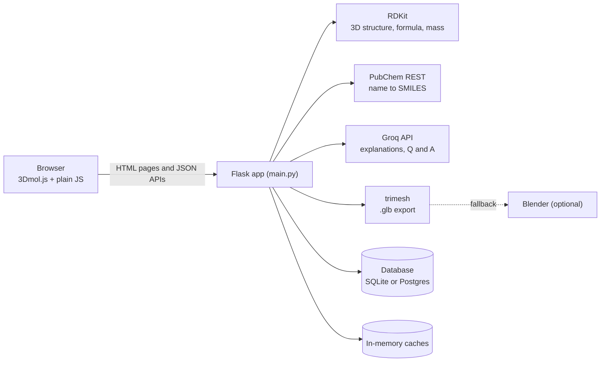
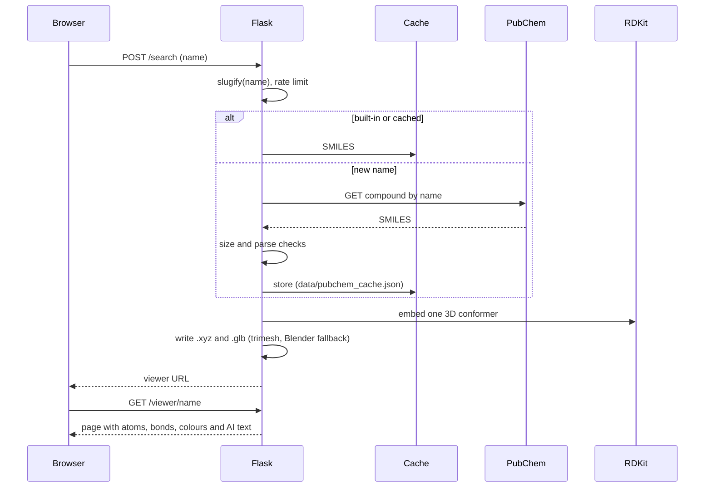
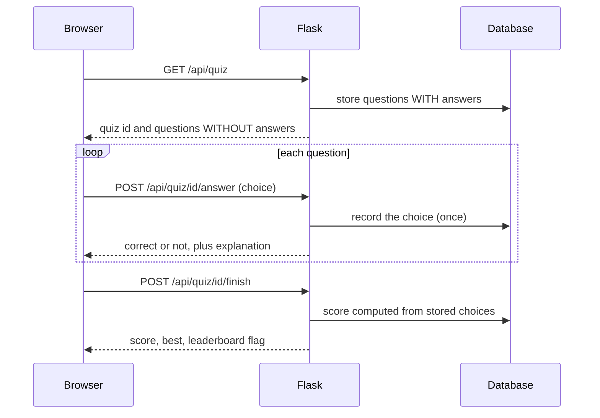

# Architecture

ChemVerse3D is a small server-rendered Flask app. The browser does the 3D drawing; the server does chemistry, caching and the AI calls.

## Components

| Piece | Responsibility |
|---|---|
| `main.py` | Routes, validation, rate limiting, security headers, error pages, caching |
| `generate_xyz.py` | SMILES to one RDKit 3D conformer (the single source of truth for atoms and bonds) |
| `elements.py` | One colour table shared by the viewer, legend and `.glb` |
| `glb_trimesh.py` | Spheres and cylinders to a `.glb` file |
| `blender_script_gen.py`, `export_glb_blender.py` | Optional fallback exporter |
| `static/js/molview.js` | 3Dmol.js wrapper: styles, labels, bond notation, hover, animation frames |
| `models.py` | SQLAlchemy models (users, favourites, quiz sessions, cached molecules and explanations) |
| `accounts.py` | Blueprint: auth, CSRF, favourites, leaderboard |
| `ratelimit.py` | Sliding-window rate limiter |
| `templates/` | Server-rendered pages: cover, search, viewer, compare, quiz, account pages, error |

## Request flows

### Searching for a molecule

### AI calls
`_groq()` is the only place that talks to Groq. Explanations are cached per molecule and comparisons per pair, so the free quota is spent once. If the key is missing or the service is down, the page still loads and shows a short message instead.

## Data and state

| Data | Where | Lifetime |
|---|---|---|
| Built-in molecules | `molecules_db.py` | Code |
| Users, favourites | Database (`user`, `favorite`) | Persistent if the database is persistent |
| Quiz attempts and scores | Database (`quiz_session`) | Finished quizzes kept; unfinished ones pruned after a day |
| PubChem molecules | Database (`custom_molecule`) plus an in-process dict | Persistent |
| AI explanations | Database (`explanation`) plus an in-process dict | Persistent |
| 3D structures, comparisons | In-memory dicts | One process |
| `.glb` and `.xyz` files | `outputs/`, `molecules/` | Rebuilt on demand |
| Rate-limit counters | In-memory deques | One process |

The database is SQLite by default (`DATA_DIR/app.db`) and any SQLAlchemy URL through `DATABASE_URL`. Tables are created at startup with `create_all()`; a migration tool (Alembic) is the next step once the schema starts to change.

### Quiz scoring

The browser never sends a score, and a quiz id is an unguessable UUID. Only finished, full-length (10-question) quizzes by signed-in users reach the leaderboard.

**Guest credit.** When a guest finishes a quiz, its id is stored in the signed session cookie. If that browser then logs in or registers, the quiz is assigned to the account, but only if it is finished, still unowned and under an hour old. The id comes from the browser's own cookie, so another browser cannot claim it, and an already-owned quiz is never reassigned.

## Security measures

| Risk | Control |
|---|---|
| Path traversal through molecule names | Names are slugged to `[a-z0-9 -]` (max 60 chars) before they key files |
| Abuse of PubChem and CPU | Heavy-atom limit; separate rate limit on new lookups |
| Abuse of the AI quota | Per-IP rate limits, input length cap, response caching |
| Spoofed client IPs | `X-Forwarded-For` is only trusted when `TRUST_PROXY=1` (set on Render) |
| Script injection | Jinja auto-escaping, `tojson` for data in scripts, no raw HTML from users or the AI |
| Compromised CDN script | Subresource Integrity hash on the 3Dmol.js tag |
| Clickjacking, sniffing, referrer leaks | CSP with `frame-ancestors`, `X-Frame-Options`, `nosniff`, `Referrer-Policy` |
| Account takeover and abuse | Passwords hashed with scrypt; the same error for a wrong password and an unknown user, with a dummy hash check so timing does not leak which; login (8 per minute) and sign-up (5 per 10 minutes) rate limits |
| Cross-site request forgery | A per-session CSRF token is required on login, sign-up, logout and every favourites change |
| Session fixation and cookie theft | New session on login; HttpOnly and SameSite=Lax cookies, Secure over HTTPS |
| Open redirects | The `next` parameter must be a same-site path (no `//` or full URLs) |
| Quiz cheating | Answers stay on the server; the server checks each answer once and computes the score |
| Oversized requests | 64 KB request body limit |
| Secrets | `.env` is git-ignored; hosts use environment variables (`SECRET_KEY`, `GROQ_API_KEY`, `DATABASE_URL`) |

## Scaling limits and next steps

| Limit | Why | Next step |
|---|---|---|
| One gunicorn worker | In-memory caches and rate limits are per process | Move them to Redis, then add workers |
| No schema migrations | Tables come from `create_all()` | Alembic |
| Free hosts wipe SQLite | Ephemeral disk | Hosted Postgres through `DATABASE_URL` |
| First view of a new molecule is slow | Embedding runs inside the request | Background job and polling |
| Groq free quota | Shared by all visitors | Persistent cache, per-user limits, a paid plan |

## Key design decisions

| Decision | Reason |
|---|---|
| trimesh first, Blender as fallback | Blender cannot run on free hosts; trimesh is pure Python and takes milliseconds |
| Hosted LLM instead of a local T5 model | Removes about 1 GB and torch; the app fits a 512 MB host |
| Live 3Dmol.js view plus a downloadable `.glb` | Labels, bond notation and animation are cheap in the browser; the `.glb` serves download and AR |
| One conformer feeds every output | The viewer, `.sdf` and `.glb` can never disagree |
| Server-rendered pages and plain JavaScript | Small pages, no build step, fast deploys |
